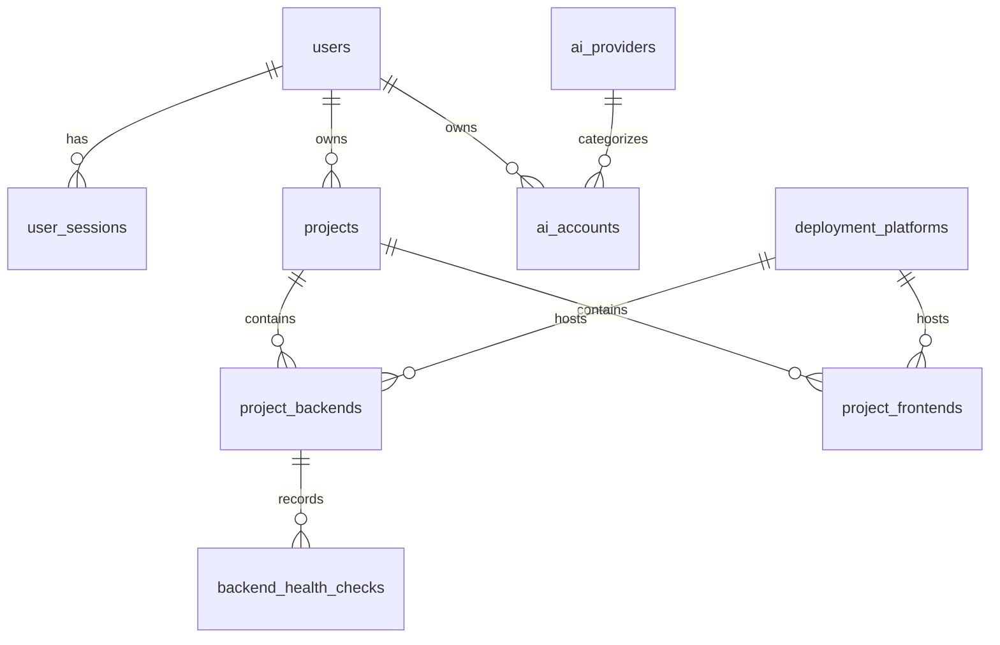

# Database Design — Dev Hub

## 1. Overview & Key Decisions

- **Engine:** PostgreSQL (15+ recommended).
- **Schema Name:** `"dev-hub"` (all tables and enum types reside in `"dev-hub"`, NOT `public`).
  - **Quoting Rule:** Because `dev-hub` contains a hyphen, every SQL statement MUST double-quote `"dev-hub"` (e.g., `SELECT * FROM "dev-hub".projects`).
- **No ORM:** Raw parameterized SQL via `pg` (`node-postgres`) with explicit TypeScript row-to-domain mappers.
- **Primary Keys:** `UUID` generated via `gen_random_uuid()`.
- **Timestamps:** `TIMESTAMPTZ` everywhere.

## 2. Entity Relationship Diagram (ERD)

## 3. Baseline Schema Review & Improvements

Reviewing the baseline 9-table proposal, the following improvements are applied:

1. **Partial Unique Indexes for Soft-Deleted Entities:**
   - Instead of plain `UNIQUE(user_id, code)` on `projects`, use `CREATE UNIQUE INDEX uq_projects_user_code_active ON "dev-hub".projects (user_id, code) WHERE deleted_at IS NULL`. This allows reusing a project `code` after soft-deletion.
   - Applied identically to `users(email)`, `users(username)`, and `project_frontends(project_id, slug)`.
2. **Database-Level `CHECK` Constraints:**
   - `project_backends`: `check_interval_seconds BETWEEN 10 AND 86400`, `timeout_ms BETWEEN 500 AND 30000`, `response_time_ms IS NULL OR response_time_ms >= 0`.
   - `project_frontends`: conditional constraint enforcing that `MODULE_FEDERATION` requires `entry_url`, `remote_name`, and `exposed_module`, while `IFRAME` and `EXTERNAL` require `application_url IS NOT NULL OR entry_url IS NOT NULL`.
   - `ai_accounts`: `email = lower(btrim(email))` to guarantee normalized emails at the DB layer.
3. **Explicit Referential Actions:**
   - `user_sessions.user_id` → `ON DELETE CASCADE`
   - `projects.user_id` → `ON DELETE RESTRICT` (projects use soft delete)
   - `project_backends.project_id` → `ON DELETE CASCADE`
   - `project_backends.deployment_platform_id` → `ON DELETE SET NULL`
   - `backend_health_checks.backend_id` → `ON DELETE CASCADE`
   - `project_frontends.project_id` → `ON DELETE CASCADE`
   - `project_frontends.deployment_platform_id` → `ON DELETE SET NULL`
   - `ai_accounts.user_id` → `ON DELETE CASCADE`
   - `ai_accounts.provider_id` → `ON DELETE RESTRICT`
4. **Worker Scheduling Index:**
   - Partial index on `"dev-hub".project_backends (is_active, last_checked_at) WHERE deleted_at IS NULL AND is_active = true` so the health worker/cron queries due backends without scanning inactive or deleted rows.

## 4. Tables Summary

| Table (`"dev-hub".*`) | Purpose | Soft Delete |
|---|---|---|
| `users` | Authenticated developer account(s) | `deleted_at` |
| `user_sessions` | Active/revoked opaque session hashes (`SHA-256`) | `revoked_at` |
| `projects` | User-owned software projects | `deleted_at` |
| `deployment_platforms` | Shared catalog of hosting platforms | `is_active` |
| `project_backends` | Backend services + latest health state | `deleted_at` |
| `backend_health_checks` | Historical health check logs (30-day retention) | Hard delete via retention |
| `project_frontends` | Frontend apps + MF/Iframe/External config | `deleted_at` |
| `ai_providers` | Shared catalog of AI providers | `is_active` |
| `ai_accounts` | User's registered emails per AI provider | Hard delete |

## 5. Migration Strategy (SQL-First Up & Down)

- Migrations live in `src/platform/database/migrations/` as paired `.up.sql` and `.down.sql` files (`0001_init_schema.up.sql` / `0001_init_schema.down.sql`, `0002_seed_catalogs.up.sql` / `0002_seed_catalogs.down.sql`, etc.).
- Tracking table: `"dev-hub".schema_migrations (version TEXT PRIMARY KEY, applied_at TIMESTAMPTZ NOT NULL DEFAULT now())`.
- Runner (`scripts/migrate.ts`) supports:
  - `up`: executes all pending `.up.sql` files in order inside transactions.
  - `down [steps]`: rolls back the latest `N` applied migrations using `.down.sql` inside transactions.
  - `status`: lists `[APPLIED]` vs `[PENDING]` migrations.
- **No destructive migrations** (`DROP TABLE`, `DROP COLUMN`) in `.up.sql` without explicit approval.

## 6. Retention & Cleanup Policy

- `backend_health_checks`: Records older than `HEALTH_RETENTION_DAYS` (default `30`) are purged in batches (`DELETE FROM "dev-hub".backend_health_checks WHERE checked_at < now() - interval '30 days'`).
- `user_sessions`: Expired or revoked sessions older than `30` days are periodically pruned.
